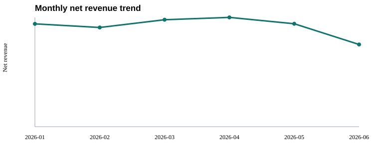

# Retail Insight Agent

> An observable, testable multi-tool agent that turns a plain-language question ("why did sales drop?") into a cleaned dataset, deterministic metrics, anomaly diagnosis and an exported report. Python standard library only; runs offline or with the OpenAI Responses API (Function Calling).

一个可运行、可追踪、可测试的零售数据分析 Agent。用户提出自然语言分析需求后，Agent 会依次检查数据、清洗异常、计算指标、检测销售下降、生成图表并导出报告。

项目重点不是用大模型直接计算数字，而是明确区分：

- Agent/模型负责理解目标、规划步骤和选择工具；
- Python 工具负责确定性数据计算；
- SQLite 保存任务状态、长期记忆和完整调用轨迹；
- JSON Schema 约束工具参数，执行层负责校验和异常处理。

## 实际运行结果

内置示例数据包含 545 行原始订单。默认流程实际执行结果：

```text
inspect_dataset
  -> clean_data
  -> calculate_metrics
  -> detect_anomalies
  -> plot_chart
  -> export_report
```

- 清洗后保留 543 行，剔除 1 条重复数据和 1 条非法数据；
- 识别出 United Kingdom 最近 30 天净销售额下降 68.3%；
- 生成 Markdown 报告、HTML 仪表盘和 SVG 趋势图；
- 每次工具调用的参数、结果、耗时和错误均写入 SQLite。

## 示例输出

以下文件来自一次真实运行（本地模式，内置示例数据），放在 [`examples/`](examples/) 中，无需运行即可查看：

| 文件 | 内容 |
|---|---|
| [`analysis_report.md`](examples/analysis_report.md) | 报告摘要：净销售额、订单数、客单价、退货率与异常诊断 |
| [`analysis_report.html`](examples/analysis_report.html) | HTML 仪表盘版报告 |
| [`monthly_revenue.svg`](examples/monthly_revenue.svg) | 月度净销售额趋势图 |
| [`trace.json`](examples/trace.json) | 结构化计划、6 次工具调用的参数、结果、耗时与状态 |



报告中的核心结论：

```text
United Kingdom: 1948.00 -> 618.00 (-68.3%)
likely drivers: units sold decreased 60.6%; return rate increased 16.7% points
```

## 快速运行

环境要求：Python 3.11 及以上，无第三方依赖。

```powershell
git clone https://github.com/Forstthia/retail-insight-agent.git
cd retail-insight-agent
python -m retail_agent generate-sample
python -m retail_agent run --query "分析最近销售额下降的原因并生成报告"
```

命令输出会给出 `session_id` 和报告路径。查看某次任务的完整调用轨迹：

```powershell
python -m retail_agent trace <session_id>
```

查看跨任务保存的数据集信息和指标定义：

```powershell
python -m retail_agent memory --user-id demo-user
```

替换为自己的 CSV：

```powershell
python -m retail_agent run --data "D:\data\retail.csv" --query "按商品分析销售下降原因"
```

CSV 必须包含：`order_id`、`date`、`country`、`product`、`customer_id`、`quantity`、`unit_price`、`returned`。

## 两种调度模式

默认 `local` 模式使用透明的 Plan-and-Execute 规划器，适合无 API Key 演示、自动化测试和结果复现。

`openai` 模式会把当前计划、短期状态、长期记忆和工具 JSON Schema 发送给 Responses API，由模型每轮选择一个 Function Call，执行结果再写回状态。

```powershell
Copy-Item .env.example .env
# 在 .env 中填写 OPENAI_API_KEY
python -m retail_agent run --mode openai --query "分析最近销售额下降的原因并生成报告"
```

密钥只从环境变量或本地 `.env` 读取，`.env` 已加入 `.gitignore`。模型模式设有最大执行步数，工具执行前会校验参数；失败调用同样会写入 trace。

## Memory 设计

短期记忆位于 `sessions` 表，包括任务目标、结构化计划、步骤状态和阶段摘要。运行时只向模型提供最近观察与结构化状态，不无限拼接历史对话。

长期记忆位于 `memories` 表，当前保存：

- 数据集字段、行数、缺失值和日期范围；
- 净销售额、退货率、复购率等业务指标口径；
- 数据按 `user_id` 隔离，可在后续任务中召回。

`tool_calls` 表是可观测性记录，不等同于 Memory：它保存调用参数、工具结果、状态、异常和耗时，用于调试与评估。

## 项目结构

```text
retail-insight-agent/
├── retail_agent/
│   ├── planner.py       # 本地计划与模型 Function Calling 选择器
│   ├── runtime.py       # Agent 循环、状态更新、步数限制与容错
│   ├── tools.py         # 6 个数据工具、Schema 与执行器
│   ├── memory.py        # SQLite 短期记忆、长期记忆和 trace
│   ├── sample_data.py   # 可复现的零售示例数据
│   └── cli.py           # run / trace / memory / generate-sample
├── data/                # 示例 CSV
├── docs/                # 架构说明
├── tests/               # 正常流程、失败轨迹、Memory、Schema、API解析
├── examples/            # 一次真实运行的报告、图表与 trace
└── outputs/             # 每个 session 的清洗数据、图表和报告（不入库）
```

## 测试

```powershell
python -m unittest discover -s tests -v
```

5 个测试覆盖：完整多工具工作流、跨任务记忆、工具参数校验、失败调用留痕，以及 Function Calling 响应解析。真实模型调用需要用户自己的 API Key 和网络，因此测试使用模拟 API 响应，不产生费用。

## 设计取舍

- 采用混合式 Agent：业务计算固定在工具中，模型只承担非确定性决策，避免数字幻觉。
- Memory 使用 SQLite 而不是向量数据库，因为当前保存的是结构化元数据和指标定义；如果加入大量文档知识，再引入 embedding 检索更合理。
- 本地规划器不是伪装成模型，而是用于离线基线和回归测试；模型模式才由模型动态选择工具。
- 示例数据是合成数据，用于证明工作流和异常检测，不能冒充真实商业数据。

更完整的设计说明见 [架构文档](docs/architecture.md)。

