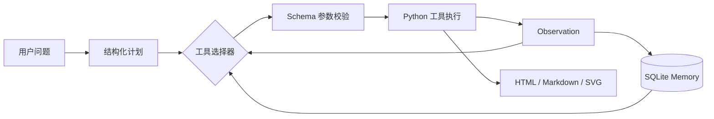

# Architecture

## 运行流程

默认模式由 `LocalWorkflowPlanner` 按结构化计划选择下一个待执行步骤。模型模式由 `OpenAIResponsesToolSelector` 读取同一份任务状态和工具定义，每轮返回一个 function call。两种模式共用执行器、Memory、工具和 trace，因此可以用本地模式建立稳定回归基线。

## 状态边界

`AgentState` 只保存本次运行需要的状态：

- 用户目标；
- 计划及每一步状态；
- 已产生的文件路径；
- 最近四条工具观察。

模型不会直接获得整份 CSV 或所有历史 trace。它只负责根据摘要选择工具，计算由工具读取数据完成。这既控制上下文长度，也避免把敏感原始数据无条件发送给模型。

## Function Calling

每个工具包含名称、用途和 JSON Schema。执行顺序为：

1. 选择器返回工具名与 JSON 参数；
2. `ToolRegistry` 验证必填字段、类型、枚举和未知参数；
3. 运行时解析 `$artifacts.*` 文件引用；
4. Python handler 执行确定性计算；
5. 结果写入 `tool_calls`，摘要回到 Agent 状态；
6. 如果工具失败，异常和耗时仍会留痕，session 标记为 failed。

模型没有直接文件系统或数据库权限，只能通过已注册工具间接操作数据。

## Memory 与 Trace

SQLite 包含三张表：

| 表 | 生命周期 | 用途 |
|---|---|---|
| `sessions` | 单次任务 | 计划、步骤状态、短期摘要 |
| `memories` | 跨任务 | 数据集元数据、指标定义等长期知识 |
| `tool_calls` | 跨任务审计 | 参数、结果、状态、异常、耗时 |

Memory 回答“下一次任务需要记住什么”，trace 回答“这一次具体发生了什么”。两者分开能避免把大量执行日志塞进模型上下文。

## 容错与边界

- 工具参数在执行前校验；
- CSV 字段、类型、重复订单和非法数值均有检查；
- Agent 设有 `max_steps`，阻止无限循环；
- 工具异常写入 trace，任务状态改为 failed；
- 业务指标由 Python 计算，模型不能改写数值结果；
- API Key 不进入代码、数据库或日志。

当前版本没有实现自动重试，因为数据错误、权限错误和暂时性网络错误需要不同策略。后续可给错误增加分类，只对限流、超时等可恢复错误执行指数退避。

## 后续扩展

- 增加任务级权限控制和数据脱敏；
- 为真实业务问题建立 expected tool sequence 和数值评估集；
- 对大量非结构化文档增加 embedding 检索；
- 用状态机支持并行工具、人工确认和断点恢复；
- 增加 Web UI 展示计划、工具调用和 Memory，而不是只展示最终报告。

